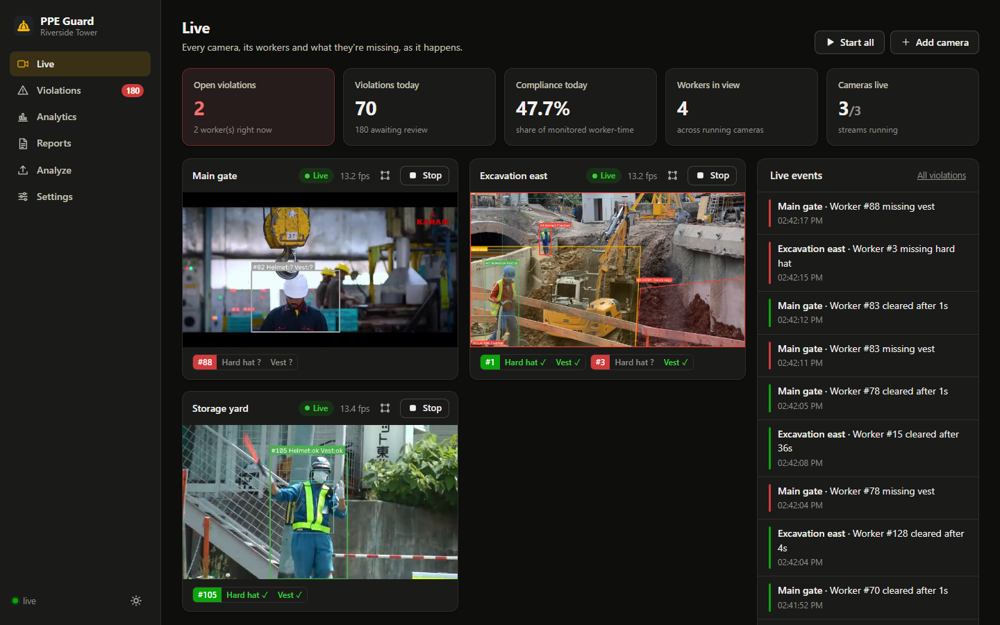
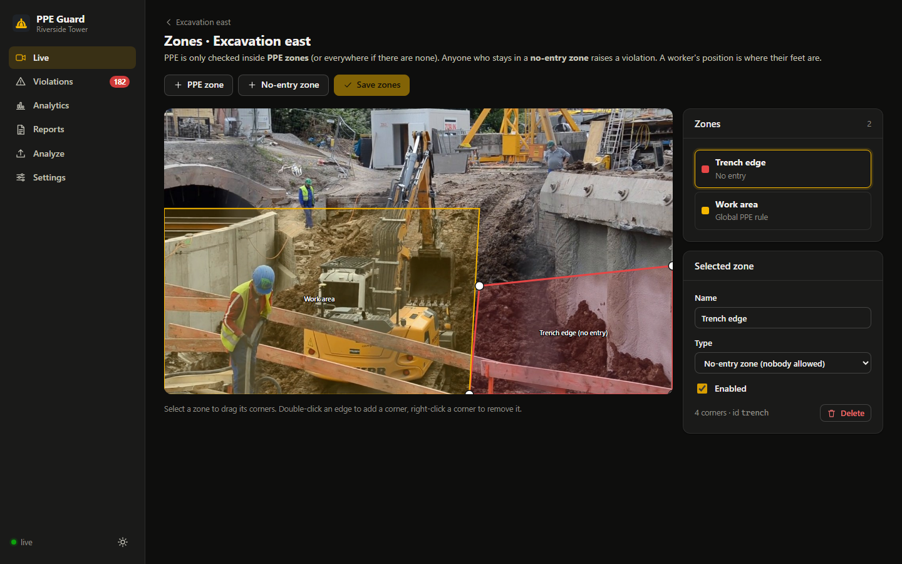
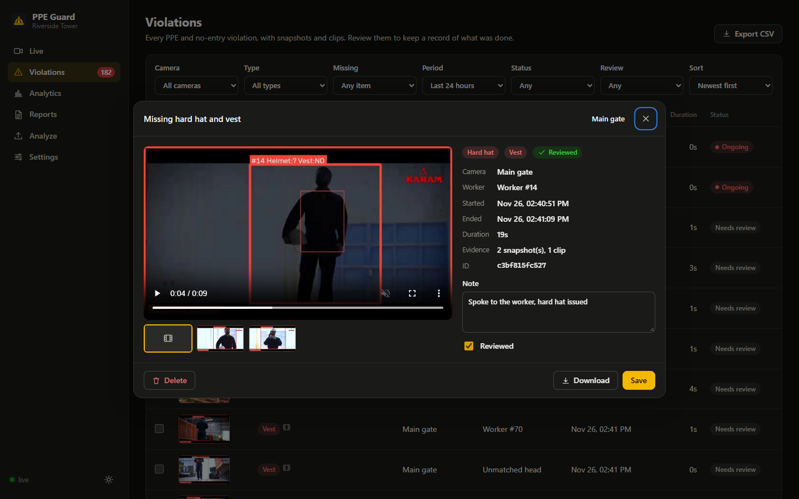
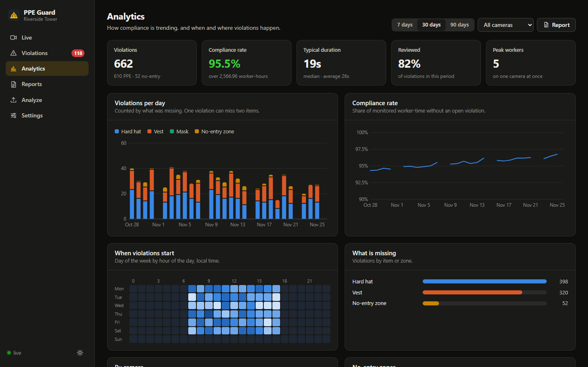
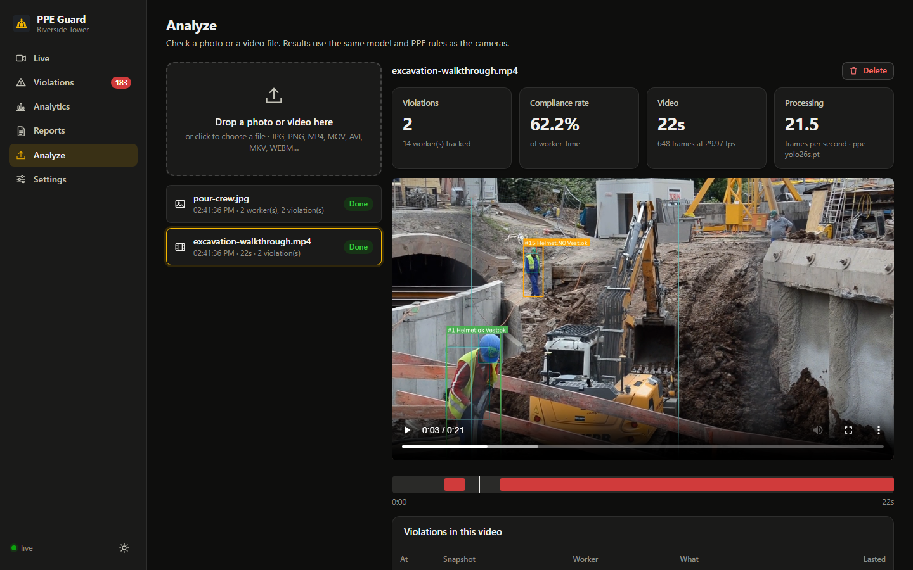
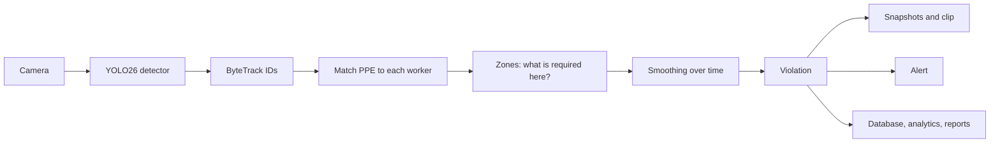

<div align="center">


# PPE Guard

**Real-time PPE monitoring for construction sites.**<br>
Checks every worker for a hard hat, safety vest and mask on any camera, enforces zones,
keeps video evidence, sends alerts and reports your compliance rate.

[](https://github.com/VoxDroid/ppe-guard/actions/workflows/ci.yml)
[](https://voxdroid.github.io/ppe-guard/)
[](LICENSE)


**[Try it in your browser](https://voxdroid.github.io/ppe-guard/demo/)** ·
[Documentation](https://voxdroid.github.io/ppe-guard/) ·
[Quick start](#quick-start) ·
[Results](#how-accurate-is-it)



</div>

## Why

Construction is one of the most dangerous industries. In the US, construction and extraction
workers accounted for **976 of the 4,764 fatal work injuries in 2020**
([BLS](https://www.bls.gov/news.release/archives/cfoi_12162021.htm)). Hard hats and
high-visibility clothing are basic controls, but checking them all day across a busy site is hard
to do by hand.

PPE Guard watches the cameras you already have. Supervisors get a short, reviewable list of
incidents with snapshots and clips, a live view of who is missing what, and numbers that show
whether things are getting better.

> [!IMPORTANT]
> PPE Guard helps people notice problems sooner. It is not a certified safety system: it will miss
> some violations and raise some false alarms. Keep your normal supervision in place, and follow
> local rules on video monitoring at work.

## Features

| | |
| --- | --- |
| **Per-worker checks** | PPE is matched to the person wearing it (overlap plus body position) and followed over time with ByteTrack. One worker's hard hat never makes another look compliant. |
| **No false alarms from one bad frame** | A violation opens only after an item has looked missing for most of a configurable delay, and closes once the worker is compliant again or leaves. |
| **Zones** | Draw areas on each camera: require PPE only where it matters, set different rules per area (masks in the paint shop), and mark no-entry zones that flag anyone who walks in. |
| **Evidence** | Snapshots and a short video clip, starting a few seconds before the violation, for every incident. Notes, review status, bulk actions and CSV export. |
| **Analytics and reports** | Compliance rate over monitored worker-time, trends, a weekday-by-hour heatmap, per-camera numbers, and printable daily or weekly reports. |
| **Alerts** | Slack, Discord or any JSON webhook, with a per-camera cooldown. A WebSocket feed for your own tools. |
| **Analyze files** | Drop in a photo or recorded video and get an annotated result with a per-worker verdict and a violation timeline. |
| **Any camera** | Webcams, video files, RTSP and HTTP streams, many at once, with automatic reconnect. |
| **Secure and private** | Runs on your hardware, nothing leaves your network. Optional password login, API tokens and login rate limiting. |
| **Easy to run** | `pip install` and one command, or Docker (CPU or NVIDIA GPU). The dashboard works on phones. Full REST API. |

<table>
<tr>
<td></td>
<td></td>
</tr>
<tr>
<td></td>
<td></td>
</tr>
</table>

## Quick start

Python 3.10 or newer. If you have an NVIDIA GPU, install the
[PyTorch build](https://pytorch.org/get-started/locally/) for it first, then:

```bash
pip install "git+https://github.com/VoxDroid/ppe-guard.git"
ppe-guard serve
```

Open <http://localhost:8000>, add a camera in **Settings → Cameras** (`0` for a webcam, a video
file, or an `rtsp://` address) and press **Start**. The model (20 MB) downloads on first use.

Before opening the dashboard to your network, set a password:

```bash
ppe-guard password set
ppe-guard serve --host 0.0.0.0
```

**With Docker:**

```bash
git clone https://github.com/VoxDroid/ppe-guard.git && cd ppe-guard
docker compose up -d --build
```

**From the command line**, without the dashboard:

```bash
ppe-guard predict site.jpg                   # one photo: a verdict per worker
ppe-guard predict photos/ --save checked/    # a folder, with annotated copies
ppe-guard predict shift.mp4 --save checked/  # a video: violations as they happen
```

Full guides: [installation](https://voxdroid.github.io/ppe-guard/getting-started/installation/),
[cameras](https://voxdroid.github.io/ppe-guard/guide/cameras/),
[zones](https://voxdroid.github.io/ppe-guard/guide/zones/),
[alerts](https://voxdroid.github.io/ppe-guard/guide/alerts/),
[security](https://voxdroid.github.io/ppe-guard/guide/security/),
[production](https://voxdroid.github.io/ppe-guard/deployment/production/) and the
[API](https://voxdroid.github.io/ppe-guard/reference/api/).

## How it works



The model detects people and PPE (`Hardhat`, `NO-Hardhat`, `Safety Vest`, `NO-Safety Vest`,
`Mask`, `NO-Mask`, plus cones, machinery and vehicles). Each PPE box is assigned to the person
who contains most of it, if it sits in a plausible place on the body. A short history per worker
and item filters out single-frame mistakes. Details:
[How detection works](https://voxdroid.github.io/ppe-guard/guide/how-it-works/).

## How accurate is it?

Fine-tuned for 200 epochs on the
[Construction Site Safety dataset](https://universe.roboflow.com/roboflow-universe-projects/construction-site-safety)
(2,605 training images). Measured on the 82 held-out **test** images, which were never used for
training or model selection:

| Model | Precision | Recall | mAP50 | mAP50-95 |
| --- | --- | --- | --- | --- |
| **ppe-yolo26s** (default) | 0.940 | 0.765 | 0.822 | **0.574** |
| ppe-yolov8s (v1) | 0.923 | 0.782 | 0.814 | 0.556 |

Bare heads (`NO-Hardhat`) are the hardest class to confirm, and small, distant, dark or occluded
workers reduce accuracy. Check footage from your own site, and
[fine-tune](https://voxdroid.github.io/ppe-guard/reference/training/) on it for the best results.
Per-class numbers, validation results and training curves are in
[Models and results](https://voxdroid.github.io/ppe-guard/reference/models/) and
[`training/results/`](training/results/).

**Capacity**: on an RTX 5060 Ti, one server processed 4 cameras at about 12 fps each, or 8 at
about 6.7 fps each, with 100,000 violations in the database and the dashboard in use. A CPU alone
manages about 15 fps in total. See [Performance](https://voxdroid.github.io/ppe-guard/deployment/performance/)
for the full stress test.

## Project layout

```text
src/ppe_guard/
  compliance.py   per-worker PPE matching, zones, smoothing and the violation lifecycle
  detector.py     YOLO + tracker wrapper and frame drawing
  camera.py       one processing thread per camera, snapshots and clips
  storage.py      SQLite: violations, evidence, worker-time and analytics
  analysis.py     the Analyze page (uploaded photos and videos)
  auth.py         optional password login and API tokens
  alerts.py       webhook alerts
  video.py        browser-playable video writing and clip recording
  server/         FastAPI app and the dashboard (plain HTML/CSS/JS modules, no build step)
  cli.py          the ppe-guard command
docs/             documentation site (MkDocs) and the in-browser demo
training/         dataset config, the original notebook, published results
tests/            unit, API and browser tests (no GPU or weights needed)
scripts/          reference-doc generator and the stress test
```

## Contributing

Bug reports, feedback from real sites, docs fixes and code are all welcome. See
[CONTRIBUTING.md](CONTRIBUTING.md). Ideas on the list: gloves, safety glasses and harness
detection (needs labelled data), per-camera schedules, and edge deployment guides (Jetson,
OpenVINO, Hailo).

## Acknowledgements and licences

- **Dataset**: [Construction Site Safety](https://universe.roboflow.com/roboflow-universe-projects/construction-site-safety)
  (export v28) from Roboflow Universe, licensed **CC BY 4.0**, mirrored on
  [Kaggle](https://www.kaggle.com/datasets/snehilsanyal/construction-site-safety-image-dataset-roboflow).
  The demo's sample photos come from its test split.
- **Detection and tracking**: [Ultralytics](https://github.com/ultralytics/ultralytics) (YOLO26,
  YOLOv8, ByteTrack integration). **Browser demo**: [ONNX Runtime Web](https://onnxruntime.ai/).
- The training notebook builds on community Kaggle work on YOLOv8 PPE fine-tuning.

PPE Guard's own code is released under the [MIT License](LICENSE). Ultralytics, and therefore the
models trained and run with it, are licensed under **AGPL-3.0** by Ultralytics. Commercial or
closed-source use may need an [Ultralytics Enterprise licence](https://www.ultralytics.com/license).
Check your obligations before deploying.

## Support

If this project helps you, you can support it through
[Ko-fi](https://ko-fi.com/izeno), [Buy Me a Coffee](https://buymeacoffee.com/izeno),
[Liberapay](https://liberapay.com/izeno) or [Open Collective](https://opencollective.com/voxdroid).
