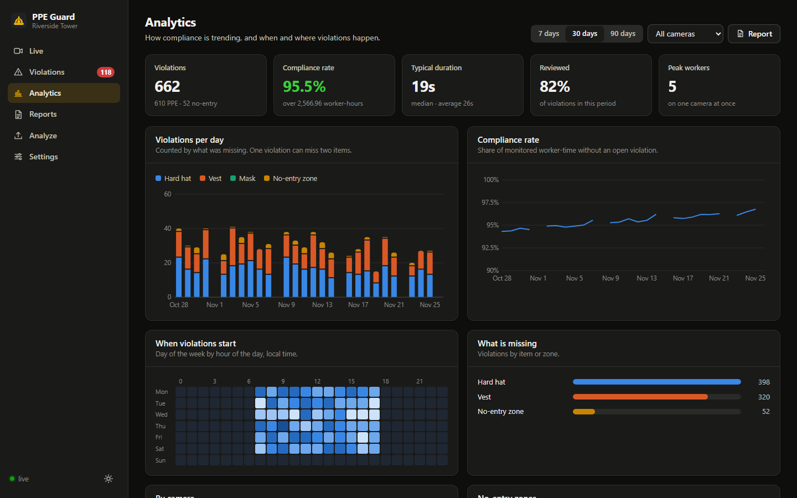

# Analytics and reports

**Analytics** summarises the last 7, 30 or 90 days, for all cameras or one. Hover over any
chart for the exact numbers.

| Tile or chart | What it shows |
| --- | --- |
| **Violations** | Count in the period, split into missing PPE and no-entry. |
| **Compliance rate** | See below. |
| **Typical duration** | Median time a violation stayed open (and the average). |
| **Reviewed** | Share of the period's violations someone has marked reviewed. |
| **Peak workers** | Most workers one camera saw at once. |
| **Violations per day** | Stacked by what was missing. A worker missing both a hard hat and a vest counts once in each colour, so a day's bar can be taller than its violation count. |
| **Compliance rate** (chart) | The rate per day. Days without monitored workers have no point. |
| **When violations start** | Day of the week by hour, darker means more. Useful for spotting the shift change, the lunch break or the end of the day. |
| **What is missing** | Totals per item and for no-entry zones. |
| **By camera** | Violations, worker-hours and compliance per camera. |
| **No-entry zones** | Entries per restricted zone. |

All times are in the server's local time zone.

## Compliance rate

Counting violations alone can mislead: a site with twice as many workers will have more
violations even if everyone is more careful. PPE Guard therefore also measures **worker-time**.

Every frame, each running camera adds the time since the previous frame to:

- **monitored worker-time**, for each worker who must wear something there (inside a PPE zone,
  or anywhere when the camera has no PPE zones) or who is in a no-entry zone, and
- **violation worker-time**, for each of those workers who is in an open violation.

The compliance rate is `1 - violation time / monitored time`. For example, 3 workers seen for an
hour each give 3 worker-hours; if one of them had an open violation for 6 minutes, the rate is
`1 - 0.1 / 3 = 96.7 %`.

Notes:

- Gaps longer than a second between frames (a frozen stream) are counted as one second, so a
  stalled camera doesn't inflate the numbers.
- Workers outside every PPE zone, and bare-head detections without a person (`?`), are not
  counted.
- Cameras write their numbers to the database once a minute and when they stop.
- The colour of a rate is green at 95 % or more, amber from 85 % and red below that.

## Reports

**Reports** builds a summary for one day or one week (Monday to Sunday), for all cameras or one:
the headline numbers, a per-day chart for weeks, a per-camera table, totals per item, up to 12
evidence snapshots and the full list of violations with their notes. It ends with a line for a
reviewer's signature.

Press **Print / PDF** and choose *Save as PDF* in the print dialog to keep or email it. The
printout is always on a white background, whatever theme you use.

## Getting the data out

- **CSV**: **Violations → Export CSV**, or `GET /api/violations/export.csv` with the same filters.
- **JSON**: `GET /api/analytics?days=30&camera_id=gate` returns everything the Analytics page
  shows, and `GET /api/report?start=2026-11-23&days=7` everything in a report. See the
  [API reference](../reference/api.md).
