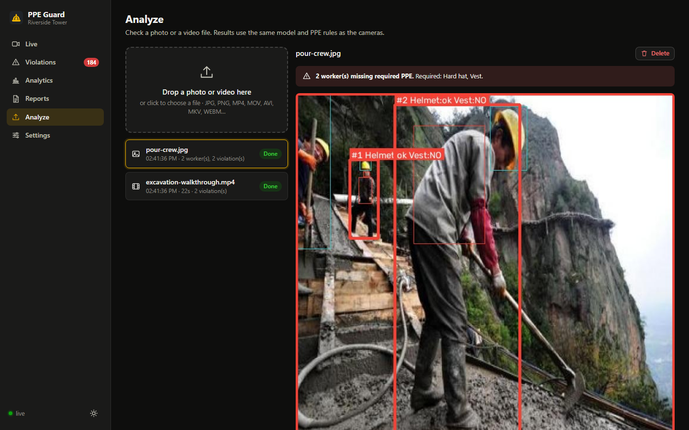
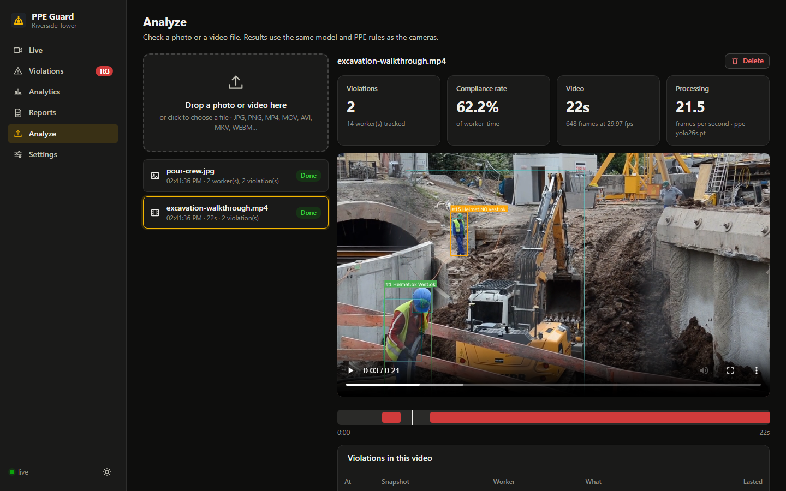

# Analyze files

**Analyze** checks a photo or a recorded video with the same model and rules as the cameras,
without setting up a camera. Use it to check footage from a phone, a drone or a body camera, or
to try PPE Guard on your own site's pictures before installing cameras.

## Photos

Drop a photo on the page (or click to choose one). The result appears in a second or two:

- a verdict (how many workers are missing required PPE),
- the annotated image,
- a table of workers with each required item marked *worn*, *missing* or *not visible*.

A photo has no time dimension, so there is no violation delay: a required item that is visibly
missing is a violation. An item that can't be seen is *not visible*, unless strict mode is on.



## Videos

Videos are processed in the background, one at a time, as fast as the hardware allows. You can
leave the page; progress continues and the result stays in the list. Each video gets:

- the annotated video, which you can play in the page or download,
- a **timeline** with a mark for each violation; click one to jump to it,
- a table of violations with the time in the video, a snapshot, the worker, what was missing and
  how long it lasted,
- the number of workers tracked and the compliance rate over the video.

Videos use the video's own clock, so the violation delay means the same as on a live camera
whatever the processing speed.



Zones are not applied to uploads, because they belong to a camera's fixed view.

## Supported files and limits

Photos: JPG, PNG, BMP, WEBP, JFIF, TIFF. Videos: MP4, MOV, AVI, MKV, WEBM, M4V, MPG, WMV (any
codec your OpenCV build can read).

Uploads are limited to **500 MB** and the last **20** results are kept. Change both in
**Settings → General**. The uploaded file itself is deleted once it has been processed; only the
annotated result and snapshots are kept.

## From the command line

`ppe-guard predict` does the same in a terminal and can process whole folders:

```bash
ppe-guard predict photos/ --save checked/
ppe-guard predict shift.mp4 --save checked/ --require helmet,vest,mask
```
