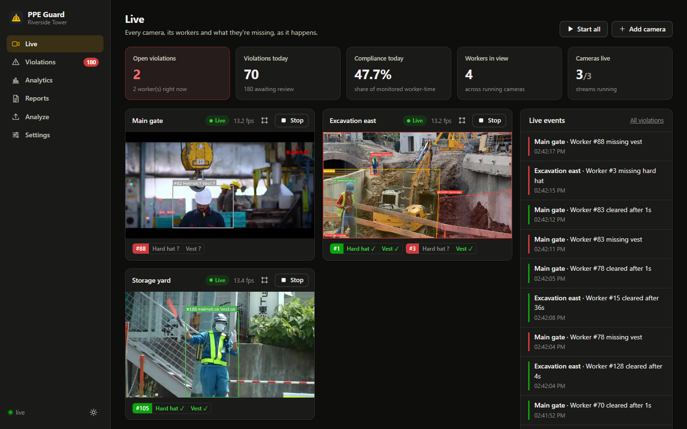
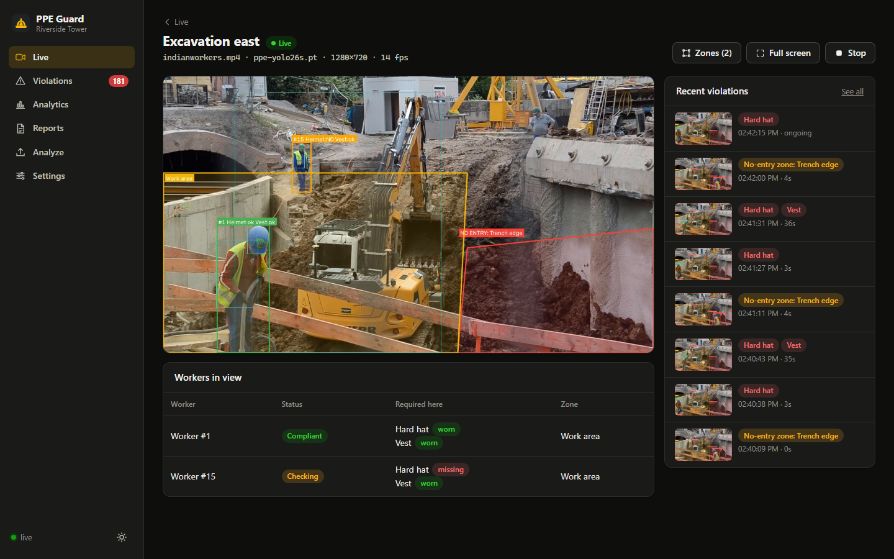
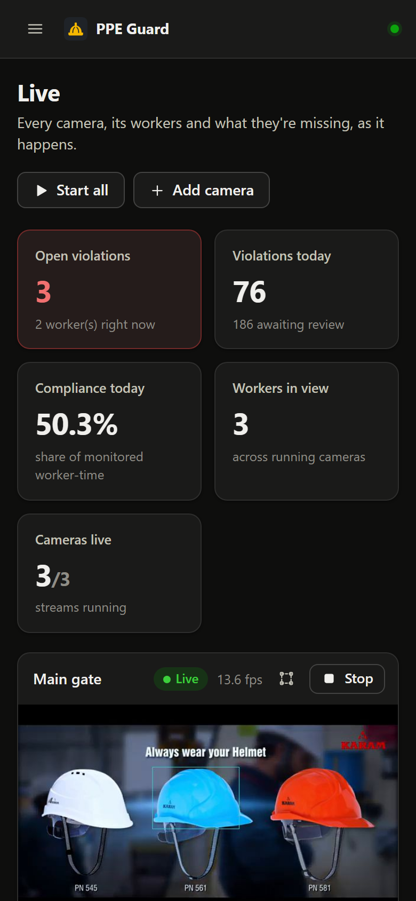
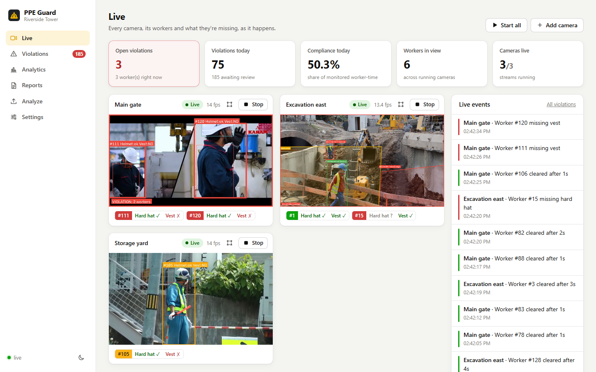

# The dashboard

`ppe-guard serve` starts a web dashboard at <http://localhost:8000>. It works in any modern
browser, on desktop and on phones, in light and dark themes (the moon/sun button at the bottom of
the sidebar).

| Page | What it is for |
| --- | --- |
| **Live** | Every camera's annotated video, who is in view, and a live feed of violations. |
| **Camera** (click a camera) | A large view, a table of workers with what each one needs and wears, and that camera's recent violations. |
| **Zones** | Draw PPE zones and no-entry zones on a camera. See [Zones](zones.md). |
| **Violations** | Every violation with filters, snapshots, clips, notes and review status. See [Violations](violations.md). |
| **Analytics** | Compliance rate, trends and where and when violations happen. See [Analytics](analytics.md). |
| **Reports** | A printable daily or weekly summary. |
| **Analyze** | Check an uploaded photo or video. See [Analyze](analyze.md). |
| **Settings** | Site name, cameras, rules, recording, alerts, security and system information. |

## Live

The tiles at the top show:

- **Open violations**: violations happening right now, and how many workers are in one.
- **Violations today**, and how many are still awaiting review.
- **Compliance today**: the share of monitored worker-time without an open violation (see
  [Analytics](analytics.md#compliance-rate)). It updates once a minute.
- **Workers in view** across running cameras.
- **Cameras live**.

Each camera card shows the annotated stream and a chip per worker, for example
`#12 Hard hat ✓ Vest ✗`. A red frame around the video means someone is in violation. The
**Start all** button starts every enabled camera.

The red badge on **Violations** in the sidebar counts violations that nobody has reviewed yet.

## Camera page

Click a camera's name or video. Besides the large view (with **Full screen**), the **Workers in
view** table lists each tracked worker's state:

| State | Meaning |
| --- | --- |
| Compliant | Wears everything required where they stand. |
| Checking | Something looks missing; waiting out the violation delay. |
| Violation | A violation is open (missing PPE or inside a no-entry zone). |
| Not visible | A required item can't be seen (for example the torso is hidden). |
| No PPE required here | The camera has PPE zones and this worker isn't in any, so nothing is required. |

## Phones and tablets

On narrow screens the sidebar becomes a menu (top left). Every page works on a phone, which is
handy for supervisors walking the site.

{ width="320" }

## Light and dark

The theme follows your system setting until you pick one with the button at the bottom of the
sidebar; the choice is remembered in that browser.

## Live updates

The dashboard keeps a WebSocket open to the server. The dot at the bottom of the sidebar shows
the connection: green when live. If the server restarts, the page reconnects by itself.
