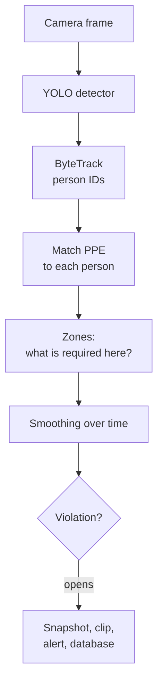

# How detection works

Knowing how PPE Guard decides helps you place cameras and tune settings.

## 1. Detection

A YOLO model finds ten kinds of objects in each frame: `Person`, `Hardhat`, `NO-Hardhat`,
`Safety Vest`, `NO-Safety Vest`, `Mask`, `NO-Mask`, `Safety Cone`, `machinery` and `vehicle`.
The `NO-*` classes are the model's way of saying "I can see a bare head" or "I can see a torso
without a vest". Detections below the **confidence** threshold (0.40) are dropped.

## 2. Tracking

ByteTrack (or BoT-SORT) links each person box to the same box in the previous frames and gives
it an ID (`#14`). That lets PPE Guard follow each worker over time instead of judging every
frame on its own.

## 3. Matching PPE to people

Each PPE box is assigned to the person box that contains most of it, if:

- at least **Overlap to assign PPE** (50 %) of the PPE box lies inside the person, and
- its centre is in a plausible place on the body, measured from the top of the person box:
  hard hats and masks in the top half (up to 45 % and 50 % down), vests between 10 % and 90 %.

So a hard hat lying on the ground at someone's feet, or held in their hand at waist height, does
not count as worn, and two people standing close together don't borrow each other's equipment.
When several boxes of the same item match one person, the most confident one wins.

A `NO-Hardhat` box that matches no person still counts: it becomes a worker of its own (shown as
`?`), because the model sometimes finds a bare head without the body under it.

For each worker and item the result is **worn**, **missing** or **unknown** (not visible).

## 4. What is required here?

The global rule says which items are required (hard hat and vest by default). [Zones](zones.md)
can narrow where it applies or change it per area, based on where the worker's feet are.

## 5. Smoothing over time

Single frames are noisy: a hard hat can be missed when someone turns their head. So each worker
keeps a short history per item covering the last **Violation delay** seconds (2 s). A violation
opens only when:

- the item was reported missing in at least 60 % of that history,
- the history spans at least half the delay, and
- the worker has been seen for at least 80 % of the delay.

While an item is missing in at least 25 % of the history, the worker shows as *Checking*. A
violation closes once the worker has looked compliant for **Clear after** seconds (3 s), or left
the picture for **Forget worker after** seconds (3 s). If a missing item merely goes out of view
during a violation (the worker turns away), the violation stays open rather than counting
"can't see it" as compliant.

**Strict mode** treats a required item that can't be seen at all as missing. Use it where every
worker must visibly wear everything, and cameras see people fully.

## 6. Evidence and alerts

When a violation opens, PPE Guard saves an annotated snapshot, starts a clip that includes the
seconds before, sends an alert (respecting the cooldown) and pushes the event to every open
dashboard. More snapshots follow every **Snapshot every** seconds while it lasts.

## Tips for good results

- **Camera placement**: as a rule of thumb, workers should be at least 60-80 pixels tall in the
  picture. Mount cameras
  high enough to see over machinery but not straight down, where helmets hide faces and vests.
- **Lighting**: night and backlit scenes reduce accuracy. Use cameras with good low-light
  performance or IR where needed.
- **Image size**: raising it (e.g. 960 or 1280) helps with small, distant workers, at the cost of
  speed.
- **Confidence**: lower it if real violations are missed, raise it if false alarms are frequent.
- **Delay**: longer delays mean fewer false alarms but later alerts.
- **Your own data**: the model learned from public images. For the best results on your site,
  label a few hundred of your own frames and [fine-tune](../reference/training.md).
