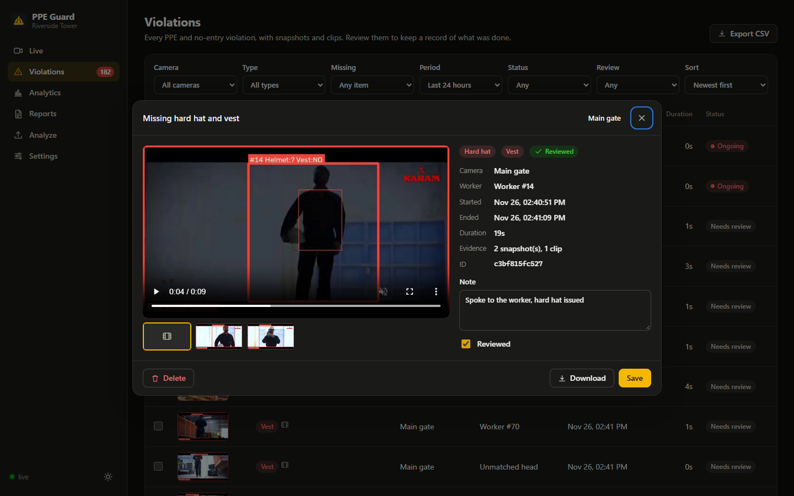
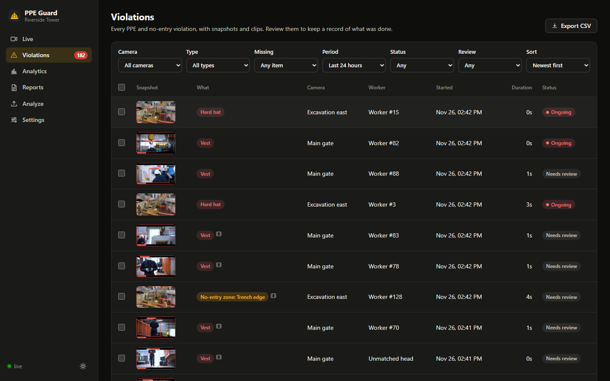

# Violations and evidence

A violation is one worker missing required PPE, or standing in a no-entry zone, for longer than
the violation delay. It stays open while that lasts and closes when the worker is compliant again
(for **Clear after** seconds) or leaves the picture.



## What is recorded

| Evidence | When |
| --- | --- |
| **Snapshot** | When the violation opens, then every **Snapshot every** seconds while it lasts, up to **Max snapshots per violation**. Full-resolution, annotated JPEGs. |
| **Video clip** | From **Seconds before** the violation opened until it closes (plus about 1.5 s), capped at **Longest clip**. Annotated, scaled to **Clip width**. Turn clips off in **Settings → Recording**. |
| **Details** | Camera, worker number, what was missing (or which zone), start, end and duration. |

Clips are saved as H.264 MP4 when the installed OpenCV can encode it, otherwise as VP8 WebM;
both play in current browsers. If neither encoder is available, clips fall back to MPEG-4 Part 2,
which browsers can't play but can download. **Settings → System** shows which one your install
uses.

## The Violations page



Filter by camera, type (missing PPE or no-entry zone), missing item, period, status (ongoing or
ended) and review status, and sort by time, duration or camera. The list updates by itself as new
violations come in.

Click a row to open it. In the detail view:

- Switch between the clip and the snapshots in the strip under the picture (or with the arrow
  keys). **Download** saves the one shown.
- Write a **Note** (what was done about it) and tick **Reviewed**, then **Save**.
- **Delete** removes the violation with its snapshots and clip.

Select several rows with the checkboxes to mark them reviewed or unreviewed, or delete them, in
one go.

## Exporting

**Export CSV** downloads the violations matching the current filters, with one row per
violation:

```text
id,type,camera_id,camera_name,worker,missing,zone,started,ended,duration_s,acknowledged,note,snapshots,clip
8e3da6d2eb4f,ppe,gate,Main gate,t14,helmet|vest,,2026-11-26T13:36:02,2026-11-26T13:36:20,18.0,True,Hard hat issued,3,8e3da6d2eb4f.mp4
```

For a formatted summary, use [Reports](analytics.md#reports).

## Keeping storage under control

Each violation takes from a few hundred kilobytes to a few megabytes, depending on the number of
snapshots and the clip length. To delete old data
automatically, set **Keep violations for (days)** in **Settings → General**. Every hour the server
deletes finished violations older than that, with their files. `0` (the default) keeps
everything. **Settings → System** shows how much space snapshots, clips and the database use.

Violations that were still open when the server stopped are closed at their last sighting on the
next start.

## Worker numbers

`#14` is the tracker's ID for a person in that camera. It stays the same while the person is
tracked, but it is not an identity: the same person gets a new number after leaving the picture,
after a long occlusion, on another camera, or when a video file loops. PPE Guard does not
recognise faces or identify people.

`?` marks a bare head or missing item found without a matching person box, which happens when a
person is partly hidden.
