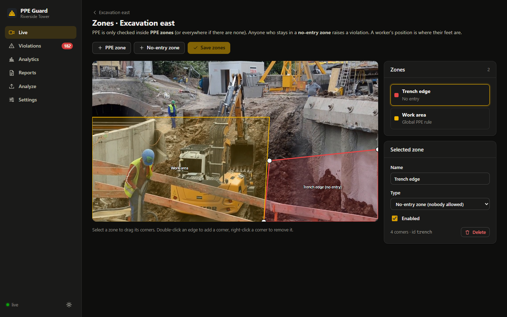

# Zones

Zones are areas you draw on a camera's picture. There are two kinds.

**PPE zones** decide *where* PPE is checked. If a camera has at least one PPE zone, workers
standing outside every PPE zone are not checked at all (they show as **No PPE required here**). Each PPE
zone can also set its own required PPE, for example masks only in the paint shop.

**No-entry zones** (restricted areas) raise a violation when anyone stays inside one for longer
than the violation delay, whatever they wear. Use them for excavations, crane swing areas,
live electrical work or anywhere people shouldn't be.

A camera without zones checks PPE across the whole picture with the global rule.



## Drawing zones

1. Open a camera and press **Zones** (or the polygon icon on its Live card).
2. Press **PPE zone** or **No-entry zone**.
3. Click on the image to place corners. Click the first corner, or press ++enter++, to finish.
   ++backspace++ removes the last corner and ++escape++ cancels.
4. Select the zone in the list to rename it, change its type or set custom PPE.
5. Press **Save zones**. Running cameras pick up the change within a second.

To adjust a zone: drag a corner to move it, drag inside the zone to move all of it, double-click
near an edge to add a corner, and right-click a corner to remove it.

The editor shows a live frame if the camera is running, or reads one frame from the source if it
is stopped.

## Where is a worker?

A worker's position is the **bottom centre of their box**, which is roughly where their feet
are. That matches how people think about areas on the ground: someone standing behind a trench
isn't "in" it just because their head overlaps it in the picture.

Two consequences:

- Draw zones **on the ground**, where feet would be.
- If a worker's feet are cut off by the bottom edge of the picture, their position is the bottom
  edge. Extend zones to the edge of the image where people can walk out of view.

## Rules inside PPE zones

| Zone setting | Required inside |
| --- | --- |
| *Custom PPE* off (default) | The global rule from **Settings → Detection & rules**. |
| *Custom PPE* on | Exactly the items ticked for the zone. |
| Several overlapping PPE zones | Everything any of them requires. |

When a worker with an open PPE violation walks out of every PPE zone, the violation closes after
the **Clear after** time, the same as when they put the item on.

## No-entry violations

A no-entry violation opens after a worker has stood in the zone for the **Violation delay**, and
closes after they have been out of it for **Clear after** seconds, or when they leave the camera's
view. It is recorded with snapshots and a clip like any violation, appears with the zone's name
(for example *Entered Trench*), and triggers [alerts](alerts.md). A worker can have a PPE
violation and a no-entry violation at the same time.

Workers inferred only from a bare head (no person box, shown as `?`) can't have a reliable foot
position, so they never trigger no-entry zones.

## Zones in the API and settings file

Zones are stored with each camera in `settings.json`, with corners normalised to 0-1. You can set
them with `PUT /api/cameras/{id}/zones`:

```json
[
  {"id": "trench", "name": "Trench", "kind": "restricted",
   "points": [[0.55, 0.55], [1.0, 0.55], [1.0, 1.0], [0.55, 1.0]]},
  {"id": "paint", "name": "Paint shop", "kind": "ppe",
   "points": [[0, 0.3], [0.5, 0.3], [0.5, 1], [0, 1]],
   "required_ppe": {"helmet": false, "vest": true, "mask": true}}
]
```

See the [configuration reference](../reference/configuration.md#zones) for every field.
