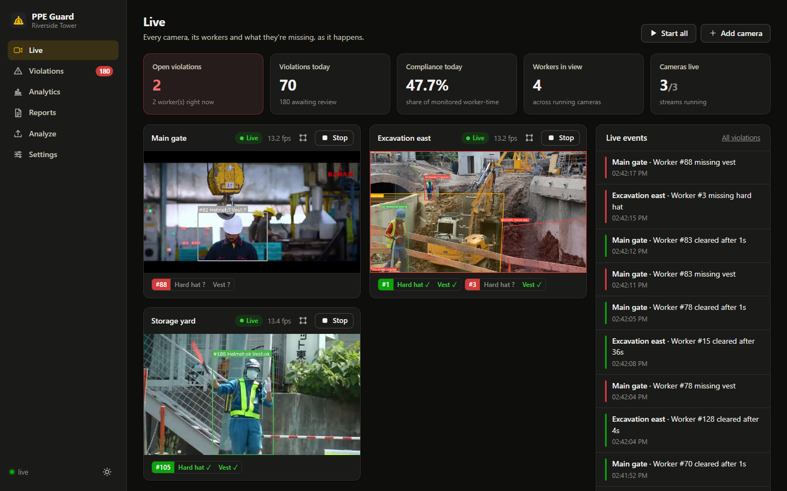
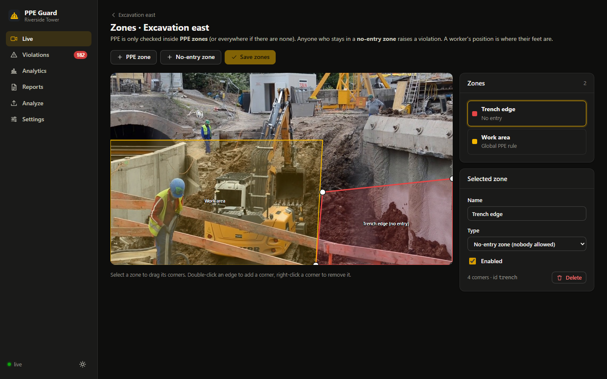
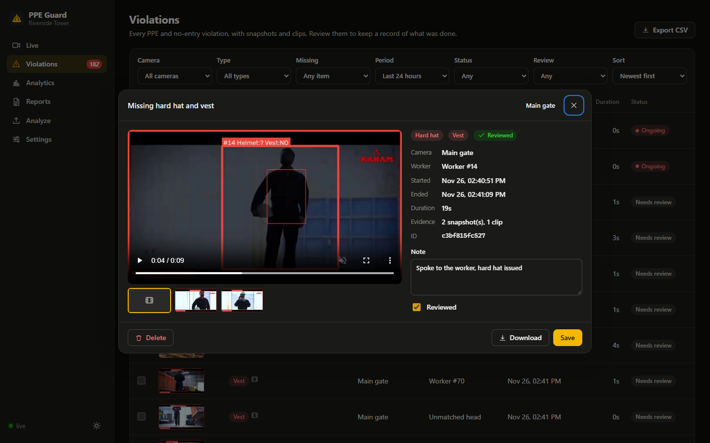
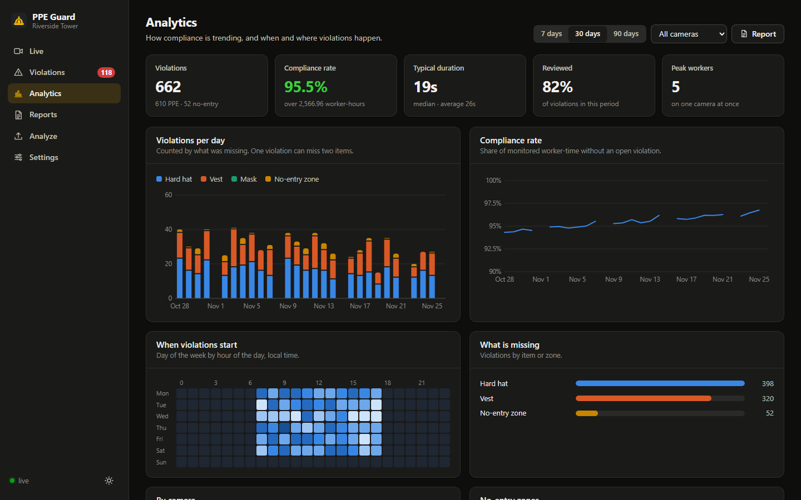
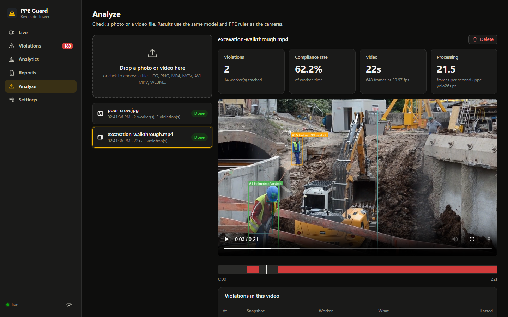

---
hide:
  - navigation
  - toc
---

<div class="hero" markdown>

<div class="hero-text" markdown>

# Know who is missing a hard hat, as it happens

**PPE Guard** watches your site cameras and checks every worker for a **hard hat**, **safety vest** and, optionally, a **face mask**. It records each violation with snapshots and a video clip, alerts your team, and turns it all into compliance reports. It runs on your own computer or server, with any webcam, video file or IP camera.

[Try it in your browser](demo/){ .md-button .md-button--primary }
[Install](getting-started/installation.md){ .md-button }
[GitHub](https://github.com/VoxDroid/ppe-guard){ .md-button }

</div>

{ .hero-shot }

</div>

<div class="grid cards" markdown>

-   :material-account-hard-hat:{ .lg } **Per-worker checks**

    ---

    PPE is matched to the person wearing it and followed over time with tracking, so one
    worker's hard hat never makes someone else look compliant.

-   :material-vector-polygon:{ .lg } **Zones**

    ---

    Require PPE only where it matters, set different rules per area, and draw no-entry zones
    that flag anyone who walks in.

-   :material-filmstrip:{ .lg } **Evidence**

    ---

    Every violation keeps snapshots and a short video clip from a few seconds before it
    started. Review, add notes and export to CSV.

-   :material-chart-bar:{ .lg } **Analytics and reports**

    ---

    Compliance rate over monitored worker-time, trends, a weekday-by-hour heatmap, per-camera
    numbers and printable daily or weekly reports.

-   :material-bell-ring:{ .lg } **Alerts**

    ---

    Slack, Discord or any webhook, with a per-camera cooldown so a busy site doesn't flood the
    channel.

-   :material-upload:{ .lg } **Analyze files**

    ---

    Drop in a photo or a recorded video and get an annotated result and a per-worker verdict,
    without setting up a camera.

-   :material-lock:{ .lg } **Private by design**

    ---

    Runs entirely on your hardware. Optional password login and API tokens. Nothing is sent
    anywhere unless you configure a webhook.

-   :material-docker:{ .lg } **Easy to run**

    ---

    `pip install`, one command to start. Docker image for CPU or NVIDIA GPU. Works on Windows,
    Linux and macOS.

</div>

## See it

=== "Live"

    

=== "Zones"

    

=== "Violations"

    

=== "Analytics"

    

=== "Report"

    

=== "Analyze"

    

## Quick start

```bash
pip install "git+https://github.com/VoxDroid/ppe-guard.git"
ppe-guard serve
```

Open <http://localhost:8000>, add a camera in **Settings → Cameras**, and press **Start**. The
model (20 MB) downloads on first use. See [Installation](getting-started/installation.md) for
GPU setup and [Docker](deployment/docker.md) for containers.

## How accurate is it?

Measured on the 82 held-out test images of the Construction Site Safety dataset, which the
model never saw during training:

| Model | Precision | Recall | mAP50 | mAP50-95 |
| --- | --- | --- | --- | --- |
| **ppe-yolo26s** (default) | 0.940 | 0.765 | 0.822 | **0.574** |
| ppe-yolov8s (v1) | 0.923 | 0.782 | 0.814 | 0.556 |

Bare heads (`NO-Hardhat`) are the hardest class to confirm. Check footage from your own site
before relying on it. Details in [Models and results](reference/models.md).

!!! warning "A tool, not a safety officer"
    PPE Guard helps people notice problems sooner. It can miss violations and raise false ones,
    so keep your normal safety procedures and supervision in place.
